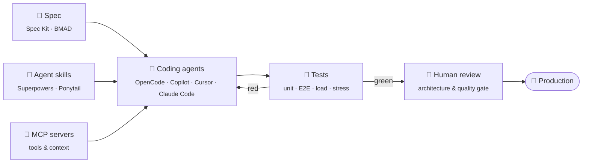

<!-- ░░░ HEADER ░░░ -->
<p align="center">
  
</p>

<p align="center">
  <a href="https://github.com/davideferrari">
    
  </a>
</p>

<p align="center">
  <a href="https://linkedin.com/in/davferrari"></a>
  
  
  
</p>

---

## `$ whoami`

**Computer Engineer** with an **M.Sc. in Computer Engineering (110/110 with honors)** from the University of Bergamo, 10+ years building backend systems, now focused on enterprise software architecture and AI-assisted development.

```kotlin
object Davide : ComputerEngineer, AgentWrangler {

    val education  = "M.Sc. Computer Engineering · University of Bergamo · 110/110 with honors"
    val role       = "Senior Lead Developer @ CompuGroup Medical · Core Team"
    val focus      = listOf("Enterprise Software Architecture", "AI-Assisted Development", "Event-Driven Systems")
    val experience = "10+ years backend · 3+ years technical leadership"
    val scope      = "architecture & dev guidelines for 8 international teams"

    val atWork     = listOf("OpenCode", "GitHub Copilot", "Cursor")
    val afterHours = listOf("Claude Code")
    val workflow   = listOf("Spec-Driven Development", "Agent Skills", "MCP", "Prompt Engineering")
    val speaks     = listOf("Kotlin", "Java", "Python", "C++", "C#")

    val awards     = listOf("CGM Star 2025", "CGM Star 2026")

    val motto      = "Doesn't matter who wrote the code. If the tests aren't green, it's not done."
}
```

## 🤖 How I ship software in 2026

> I don't "prompt and pray". I give agents a spec, guardrails and a test suite, and I keep the architecture decisions for myself.



I brought this way of working to my team: **agent skills (Superpowers, Ponytail), Spec-Driven Development with Spec Kit, and OpenCode** are now part of how we build.

## 🚀 Case study: legacy → event-driven, rewritten with AI

A single-instance **Spring WebFlux** service, built on custom libraries that few people could still touch. I rewrote it from scratch, **entirely with AI development tools**, as a multi-instance **Spring Boot** service on an **event-driven architecture with RabbitMQ**.

<table align="center">
  <tr>
    <td align="center"><h3>⏱️ ~4 months</h3><sub>from zero to production rewrite</sub></td>
    <td align="center"><h3>🧪 100 → 500+</h3><sub>unit & end-to-end tests</sub></td>
    <td align="center"><h3>📈 1 → N</h3><sub>single instance to multi-instance</sub></td>
    <td align="center"><h3>🔥 Load & stress</h3><sub>sized on real user numbers</sub></td>
  </tr>
</table>

## 🧰 AI toolbox

<p>
  
  
  
  
  
  
  
  
  
</p>

## 🏗️ Stack & enterprise architecture

<p align="center">
  
  <br/>
  
</p>

<p align="center">
  <code>Microservices</code> · <code>Event-Driven Architecture</code> · <code>Distributed Systems</code> · <code>System Design</code> · <code>RESTful APIs</code> · <code>Cloud-Native</code> · <code>Caching</code> · <code>CI/CD</code>
</p>

## 📡 Currently

- 🧠 Going deeper on **agentic workflows**: agents, skills and MCP wired into real delivery pipelines
- 📐 Scaling **spec-driven development** from one team to many
- 🧑‍🏫 Mentoring devs and running internal training (PostgreSQL indexing, microservices, Angular)

<details>
<summary><b>🎓 Recent certifications</b></summary>
<br/>

| | Certification | Year |
|---|---|---|
| 🤖 | [AI Coder: Complete Claude Code & Coding Agents Course](https://www.udemy.com/certificate/UC-7b110c49-024c-489c-9c33-9b71f2801d66/) | 2026 |
| 🧪 | [AI-Driven Software Development and Testing](https://www.udemy.com/certificate/UC-e5111e37-aff0-4708-a24a-b271f5166d3a/) | 2026 |
| 📐 | [Mastering the System Design Interview](https://www.udemy.com/certificate/UC-82c65bd1-1302-4596-92d3-1dfc91092ff3/) | 2025 |
| 🧩 | [Microservices: Designing Highly Scalable Systems](https://www.udemy.com/certificate/UC-9a0cc768-a2f9-400a-ba21-126d26c749b4/) | 2024 |
| 🐍 | AI Programming with Python Nanodegree · Udacity | 2019 |

</details>

## 🐝 Off the keyboard

Hobby beekeeper · AIS-certified sommelier 🍷 · mentor of high-school and university students in CS & math

---

<p align="center">
  <a href="https://linkedin.com/in/davferrari"><b>Let's talk architecture, agents, or wine →</b></a>
</p>

<p align="center">
  
</p>
